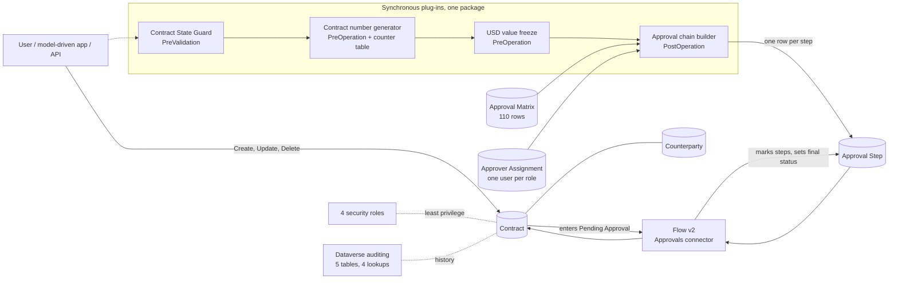

# Muwafaqa

A contract and approval management system on Microsoft Power Platform: Dataverse tables and a model-driven app, C# plug-ins that enforce the rules on the server, and a Power Automate flow that runs a multi-level approval chain. It is modeled on a real multi-level approval process in the hospitality sector (maintenance, procurement, insurance, sales and services contracts). **All data in this repository is fictional, and the approval limits are placeholders, not real thresholds.**

It is a portfolio project for the PL-400 and AB-620 skill areas. I designed, directed and verified it, and built it together with AI tools (see "How this was built"), in a single Dataverse development environment.

## Architecture



- **Tables (6):** Counterparty, Contract, Approval Matrix, Approver Assignment, Approval Step, Contract Number Counter. Publisher prefix `mwf`, one unmanaged solution.
- **Plug-ins (4 classes, 7 steps):** the state guard (Create, Update, Delete), the contract number generator, the USD value freeze and the approval chain builder.
- **Flow v2:** triggered when a contract enters *Pending Approval*; it reads the step rows, asks each approver through the Approvals connector (1 to 5 steps, the last one may only inform), writes the decision back to the step and sets the final status.
- **Security roles (4):** Requester, Approver, Finance, Admin, with least privilege and no privilege at all on the counter table.
- **Auditing:** on five tables and four lookup columns.

### Why the rules live in plug-ins, not in the flow
A flow starts after the transaction has committed and can be skipped or raced; a plug-in runs inside the transaction on every path (the app, the API, a flow, a bulk operation). A client-side form rule stops nobody who uses the API. That is the reason for the split: the server enforces, the flow only runs the human approvals. Concrete cases from this project: an old flow run once wrote *In Force* over a contract the user had already returned to Draft (ADR-004); the contract number needs a lock inside the transaction (ADR-006); the approval chain and the USD value must be frozen in the same transaction as the status change so the flow always sees them (ADR-003, ADR-007). **Trade-off:** plug-ins need C#, a package registration and a deployment for every change, and they run in the sandbox.

### Design decisions
- [ADR-001](docs/decisions/ADR-001-dedicated-solution.md): a dedicated solution and the publisher prefix `mwf`; base currency TRY, base language English.
- [ADR-002](docs/decisions/ADR-002-contract-number.md): the contract number starts as plain text and becomes generated later.
- [ADR-003](docs/decisions/ADR-003-usd-value-at-submission.md): the USD value is computed with the current rate and frozen when the contract is submitted; it fails loudly if a rate is missing.
- [ADR-004](docs/decisions/ADR-004-contract-state-guard.md): the Contract State Guard: allowed status changes, locked columns, no delete after submission.
- [ADR-005](docs/decisions/ADR-005-approval-round.md): an approval round counter, so a stale approval run can be told from the current submission.
- [ADR-006](docs/decisions/ADR-006-contract-number-generator.md): a number per contract type from a counter table, locked inside the transaction.
- [ADR-007](docs/decisions/ADR-007-approval-chain.md): the approval chain is built from the matrix and frozen as step rows at submission; flow v2 executes it (the first flow, v1, was retired).
- [ADR-008](docs/decisions/ADR-008-security-roles.md): the four roles, least privilege, no bypass privilege, nothing on the counter table.
- [ADR-009](docs/decisions/ADR-009-auditing.md): Dataverse auditing; the 365-day retention is provisional.

## What is built and tested

Every number below comes from the documents linked next to it; the test scripts print PASS / FAIL / OBS (an observation that is not a pass or fail).

| Area | Result | Run with |
|---|---|---|
| Plug-in unit tests (`dotnet test`) | 346 passed, 0 failed | no environment needed |
| Script unit tests (`node --test`) | 216 tests: 215 pass, 1 skipped on purpose (it compares a constant with a file that no longer exists), 0 fail | no environment needed |
| State guard, server | 76 PASS, 0 FAIL, 4 OBS (last run 2026-10-25, after flow v1 was deleted; [ADR-007](docs/decisions/ADR-007-approval-chain.md), regression section; design in [ADR-004](docs/decisions/ADR-004-contract-state-guard.md)) | my account (a System Administrator) through the Web API |
| Contract number, server | 18 PASS, 0 FAIL in the full run (last run 2026-10-25, [ADR-007](docs/decisions/ADR-007-approval-chain.md), regression table); 20 parallel creates, three rounds in a row, gave unique consecutive numbers ([ADR-006](docs/decisions/ADR-006-contract-number-generator.md)) | same |
| USD freeze, server | 10 + 1 + 5 PASS (last run 2026-10-25; [ADR-003](docs/decisions/ADR-003-usd-value-at-submission.md)) | same |
| Approval round, server | 13 PASS, 0 FAIL, 1 OBS (last run 2026-10-25, [ADR-007](docs/decisions/ADR-007-approval-chain.md), regression section; design in [ADR-005](docs/decisions/ADR-005-approval-round.md)) | same |
| Approval chain builder, server | 37 PASS, 0 FAIL, 3 OBS (last run 2026-10-25; [ADR-007](docs/decisions/ADR-007-approval-chain.md)) | same |
| `CreateMultiple` / `UpdateMultiple` against the guard | 31 PASS, 0 FAIL, 4 OBS (last run 2026-10-25; [ADR-007](docs/decisions/ADR-007-approval-chain.md)) | same |
| Schema read-back | 42 PASS, 0 FAIL, 2 OBS with `--cascade-test` (last run 2026-10-25: the alternate key rejected a duplicate step with HTTP 412, deleting a Draft contract deleted its 3 steps); the read-only run of 2026-10-24 gave 35 PASS, 0 FAIL, 3 OBS | same |
| Flow v2 with real approvals, cases A to D | 6, 6, 6 and 7 PASS, 0 FAIL ([ADR-007](docs/decisions/ADR-007-approval-chain.md)) | I turned the flow on and answered each approval request |
| Flow v2 failed endings | 7 PASS (no step rows) and 8 PASS (a role with no active approver) | I turned the flow on; no approval request was created |
| Security roles, behavior | per role, with the platform-added privileges removed: Requester 40, Approver 22, Finance 25, Admin 28 PASS, 0 FAIL ([ADR-008](docs/decisions/ADR-008-security-roles.md)); the stored privileges equal the design (8, 3, 9 and 22) | **a non-interactive application user**, not a person |
| Auditing, behavior | 23 PASS, 0 FAIL, 6 OBS (run 2026-10-24, [ADR-009](docs/decisions/ADR-009-auditing.md)); audit rows appeared within 18 to 58 seconds of an operation (upper bounds, polled every 10 s) | my account |
| Auditing, change of the approver user (`mwf_user`) | 10 PASS, 0 FAIL, 4 OBS (run 2026-10-25, [ADR-009](docs/decisions/ADR-009-auditing.md), "Update 2026-10-25"): old and new value, the executing user, the Create and Delete rows; lag 21 to 26 s (polled every 10 s). User B was a non-interactive application user, not a second person; no non-admin caller was tested | my account |

The seed data (110 approval-matrix rows, 5 approver assignments, 5 number counters) is loaded by scripts, and the demo files in `data/` are fictional.

## What is not tested, and known limitations

The full list is in [docs/rebuild-runbook.md](docs/rebuild-runbook.md), section 5. The honest short version:

- **The solution import has never been run**, in any environment. `pac solution pack` of `src/` works; the import and what it brings (or does not bring) are untested.
- The plug-in package file is not in the repository; it is rebuilt from `plugins/` and registered by script. Registering it as one fresh sequence in a new environment was not done.
- **Roles were tested only with a non-interactive application user.** An interactive user, team membership and access to the model-driven app were not tested. Whether the nine privileges the platform adds to custom roles come back after an import is not known (four of them did come back on one role when privileges were added to it, and were removed again).
- The audit configuration (organization settings) is not part of the solution; a change of the approver user on an assignment row was tested only with me as the caller and an application user as the new value (ADR-009); the volume of the platform's own audited tables was measured only while the environment was quiet.
- The flows run with my connection, so approvals depend on one person's account. Column security was not decided.
- The Flow checker passed a flow design that then failed on turn-on; a flow is only proven by running it.
- The model-driven app, its forms and views exist but are not covered by automated tests; three guard cases were checked by hand in the app.
- The regression scripts expect the starting state of the development environment (a configurable contract count; 110 matrix rows and 5 assignments are fixed).
- All behavior tests ran in one development environment.

## Environment note

The development environment is an unmanaged Developer environment. Per Microsoft Learn (page dated 2026-10-08), such environments are suspended starting 15 December 2026 and deleted starting 15 January 2027. The repository is therefore built to be rebuilt in a new environment, and [docs/rebuild-runbook.md](docs/rebuild-runbook.md) is the plan for that (draft, tagged by what was tested, what comes from Microsoft documentation and what is untested).

## Roadmap (not built)

Nothing in this list exists yet.

- Reminders and escalation of pending approvals.
- Delegation with a cap.
- Obligations per contract.
- Renewal and expiry alerts.
- Power BI reporting.
- An ALM pipeline (the `pipelines/` folder is empty).
- A Copilot Studio agent that checks a contract for completeness.
- A PCF timeline control (`pcf/` is empty); because the Requester cannot read approval steps directly, it would go through a server-side call.

## Repository structure

```
src/         unpacked solution (tables, roles, flow v2, app, plug-in steps)
plugins/     the C# plug-ins and their unit tests
scripts/     Node scripts: create and verify schema, seed data, server tests, audit and role tools (see scripts/README.md)
docs/        specifications, the plug-in registration log, the rebuild runbook
  decisions/ ADR-001 to ADR-009
data/        fictional seed and demo data
pcf/         placeholder (empty)
pipelines/   placeholder (empty)
```

## How this was built

I designed, directed and verified Muwafaqa, and I built it together with AI tools. Nothing here was produced without my direction.

- **Me:** I set the requirements and make every design decision (the ADRs record each decision and the trade-off I accepted). I do the work in the Power Platform portals myself (maker portal, Power Automate, admin center). I decide when anything runs: I am the only person who turns the flow on or off, and I answered the approval requests in the live flow tests myself. I review every result and decide what counts as tested.
- **An AI coding assistant** writes the code, scripts and documents under my instructions, and runs a script against the environment only after I approve it explicitly.
- **An AI chat assistant** helps me plan and review.

In this build the coding assistant was Claude Code and the chat assistant was Claude (both from Anthropic); the process does not depend on a particular model. The AI assistance is disclosed in the commit history: the commits carry `Co-Authored-By` trailers naming the assistant.

## Security and confidentiality

All data is fictional: no real contracts, organizations, people, account numbers or prices. Secrets and tokens are never stored in the repository (test credentials come from environment variables); an environment host appears only as the placeholder `<ORG_HOST>`, and the exported flow is scrubbed by `scripts/scrub-emails.mjs` after every sync. Before publication the git history was rewritten to remove an environment host and a personal email address from earlier commits, so the commit hashes quoted in the documents are the ones after the rewrite.

## License

[MIT](LICENSE).
